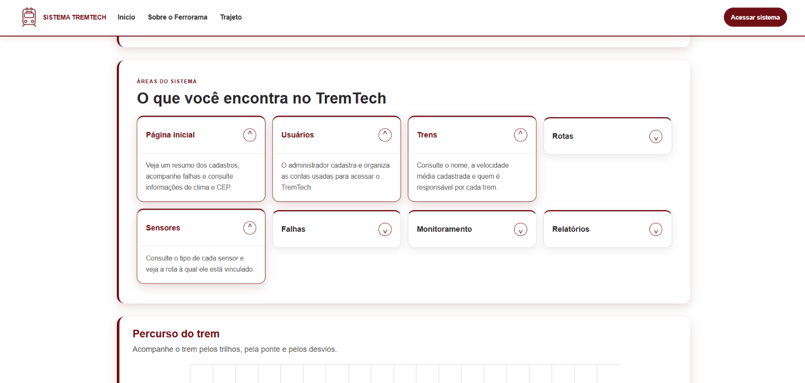
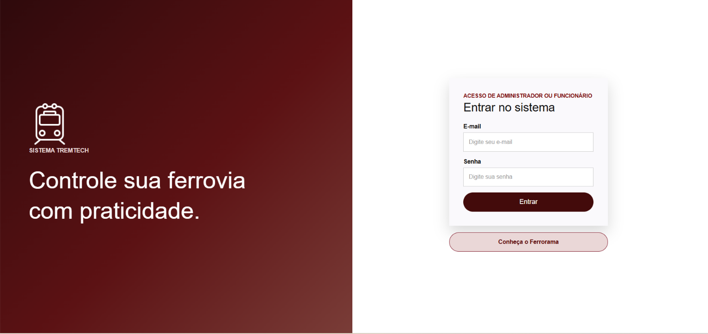
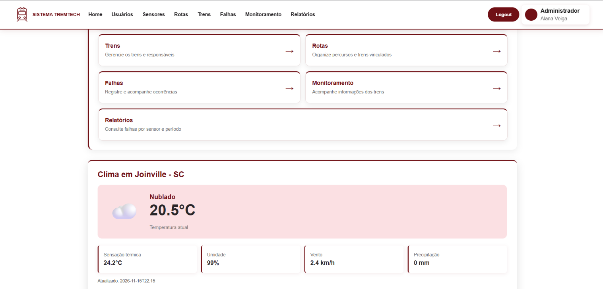
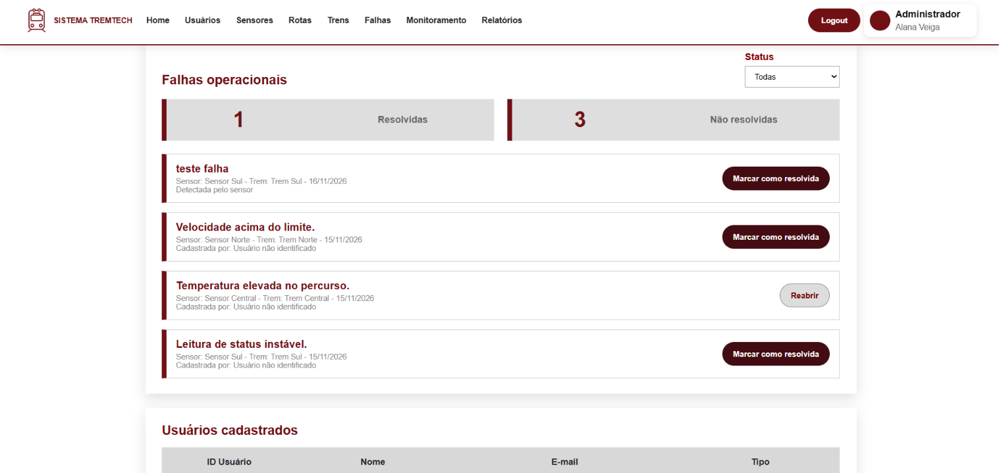
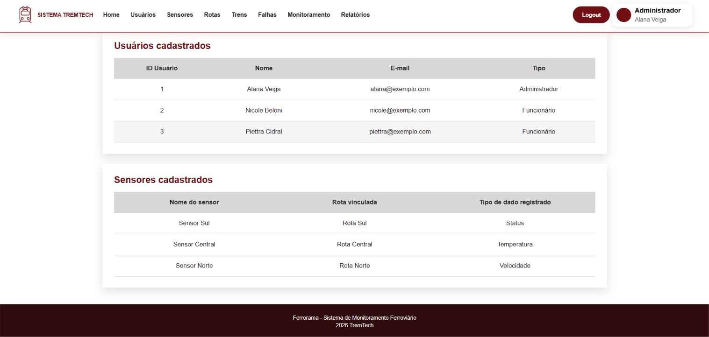
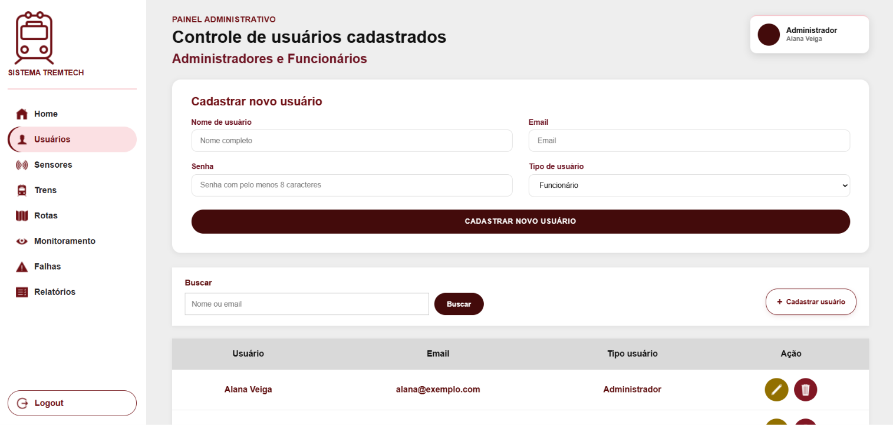
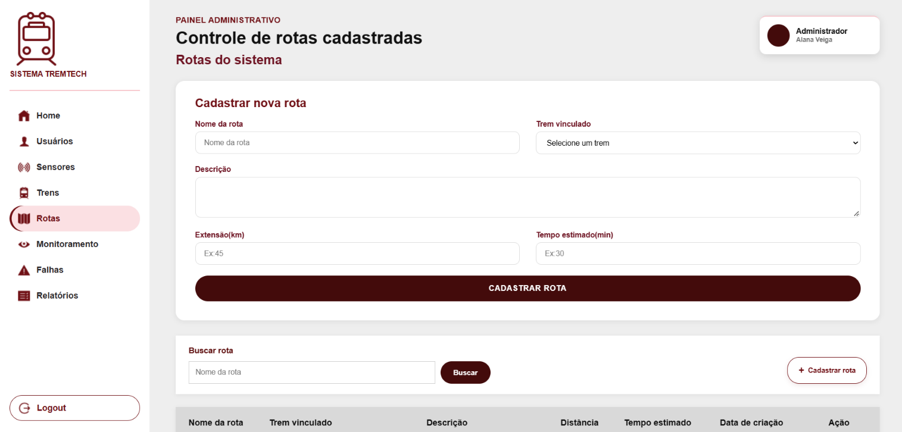
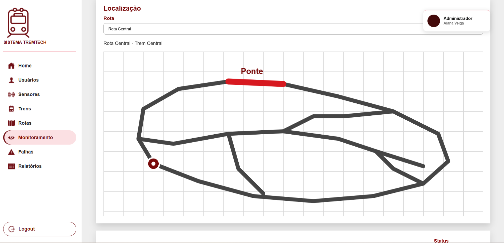
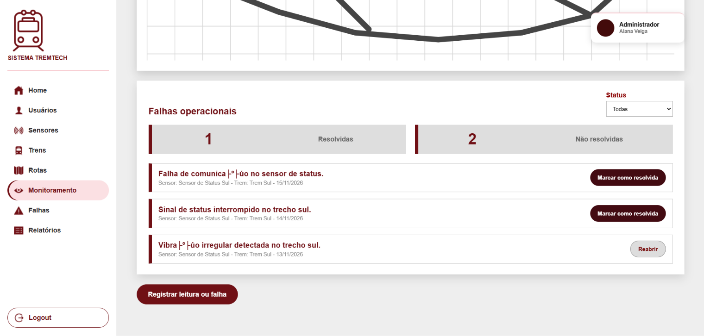

# Ferrorama — TremTech

O TremTech é um sistema web para organizar as informações da Ferrorama, uma ferrovia em escala com trens e percursos. Ele permite gerenciar usuários, trens, rotas, sensores e falhas.

## Problema que o sistema resolve

As informações da Ferrorama podem ficar espalhadas, dificultando a organização e o acompanhamento da operação. O TremTech reúne esses dados em um só lugar para facilitar a consulta e o trabalho da equipe.

## Objetivos e funcionalidades

O objetivo do sistema é facilitar a organização e o acompanhamento da Ferrorama.

As principais funcionalidades são:

- Login com e-mail e senha.
- Acesso separado para administradores e funcionários.
- Cadastro e consulta de usuários, trens, rotas e sensores.
- Edição e exclusão de registros por administradores.
- Associação de responsáveis aos trens.
- Associação de rotas e sensores aos trens.
- Registro e acompanhamento de falhas.
- Alteração de falhas para resolvidas ou não resolvidas.
- Monitoramento por sensor, com informações de velocidade e temperatura.
- Exibição de um percurso animado.
- Consulta de relatórios de falhas por sensor e mês.
- Consulta de clima e preenchimento de endereço por CEP.

Os requisitos completos estão em [requisitos.md](requisitos.md).
As orientações de uso estão em [manual.md](manual.md).

## Tecnologias utilizadas

- HTML: estrutura das páginas.
- CSS: aparência das telas.
- JavaScript: interações, animações e validações.
- PHP: funcionamento do sistema e comunicação com o banco.
- MySQL: armazenamento dos dados.
- Apache e XAMPP: execução local do sistema.
- Git e GitHub: controle de versões e armazenamento do código.
- GitHub Projects: organização das tarefas.

## Requisitos para executar

- XAMPP com Apache, PHP e banco de dados.
- PHP na versão [informar a versão testada].
- MySQL ou banco compatível na versão [informar a versão testada].
- Extensão PHP para conexão com o banco: [informar mysqli ou PDO MySQL].
- Navegador atualizado com JavaScript habilitado.
- Arquivos do projeto e arquivo SQL.
- Internet para utilizar as consultas de clima e CEP.

## Instalação e configuração

- Instale o XAMPP.
- Baixe o projeto pelo repositório: [inserir o link].
- Extraia os arquivos, caso tenha baixado um ZIP.
- Coloque a pasta do projeto dentro da pasta `htdocs` do XAMPP.
- Se o XAMPP estiver instalado no local padrão e a pasta se chamar `TremTech`, o caminho será `C:/xampp/htdocs/TremTech/`.
- Confira se o arquivo `index.php` está dentro dessa pasta.
- Configure o banco de dados seguindo as instruções abaixo.

## Configuração e importação do banco de dados

- Abra o painel do XAMPP.
- Inicie os serviços Apache e MySQL.
- Acesse `http://localhost/phpmyadmin/` no navegador.
- Localize o arquivo `database/[nome-do-arquivo.sql]`.
- Se o arquivo SQL não criar o banco automaticamente, crie um banco chamado `[nome-do-banco]` e selecione-o.
- Clique em **Importar**, escolha o arquivo SQL e execute a importação.
- Confira se as tabelas foram criadas.
- Abra o arquivo de conexão `infra/[nome-do-arquivo-de-conexao.php]`.
- Configure o servidor, o nome do banco, o usuário e a senha de acordo com seu ambiente local.
- Salve as alterações.

### Primeiro acesso

- [Explicar como criar ou acessar o primeiro administrador, conforme o funcionamento real do projeto.]
- Caso existam contas de demonstração, informe apenas credenciais fictícias e exclusivas para esse uso.
- Não publique senhas reais no README ou no repositório.

## Como iniciar a aplicação

- Abra o painel do XAMPP.
- Inicie Apache e MySQL.
- Para abrir a página pública, acesse `http://localhost/TremTech/public/Tela_landing/landing.php`.
- Para abrir o login diretamente, acesse `http://localhost/TremTech/index.php`.
- Entre com uma conta cadastrada no banco.
- Após o login, o sistema abrirá a página inicial.
- Para sair, utilize a opção de logout.

Se a pasta do projeto tiver outro nome ou o Apache utilizar outra porta, ajuste os endereços.

## Perfis de acesso

### Administrador

- Consultar, cadastrar, editar e excluir usuários, trens, rotas e sensores.
- Registrar falhas.
- Resolver ou reabrir falhas.
- Acessar a página inicial, o monitoramento e os relatórios.

### Funcionário

- Consultar as informações liberadas pelo sistema.
- Acompanhar as falhas.
- Acessar a página inicial, o monitoramento e os relatórios.
- Não pode cadastrar, editar ou excluir registros nem alterar a situação das falhas.

## Estrutura do projeto

- `assets/`: arquivos CSS e imagens.
- `database/`: arquivo SQL do banco de dados.
- `doc/`: pesquisas e documentos do projeto.
- `infra/`: autenticação e configuração da conexão com o banco.
- `public/`: página pública e telas do sistema.
- `public/Tela_landing/landing.php`: página de apresentação.
- `script/`: interações e validações da interface.
- `index.php`: tela de login.
- `logout.php`: encerramento da sessão.
- `README.md`: apresentação e instruções de instalação.
- `requisitos.md`: requisitos e regras de negócio.
- `manual.md`: orientações de uso.

## Integrantes e contribuições

- **Alana:** organizou a equipe e a estrutura do projeto, pesquisou sobre CRUD e contribuiu com a documentação, a licença, a estilização e o desenvolvimento de telas.
- **Piettra:** trabalhou no README, no login, nas telas de cadastro e em outras partes da aplicação, além de colaborar com a estilização e os ajustes visuais.
- **Nicole:** desenvolveu a tela de home, pesquisou a identidade visual e colaborou na criação e nos ajustes de outras telas.

## Imagens da versão final

### Página pública

### Login

### Página inicial

### Usuários

### Trens

### Rotas

### Sensores

### Falhas

### Monitoramento

### Registro de leituras

### Relatórios

## Limitações conhecidas

- O sistema foi desenvolvido para execução local.
- As consultas de clima e CEP dependem de internet e da disponibilidade dos serviços externos.
- O percurso é apresentado por uma ilustração fixa com marcador animado.
- [Informar se os dados de velocidade e temperatura são simulados, calculados ou recebidos de sensores físicos.]
- [Adicionar outras limitações conhecidas, caso existam.]
