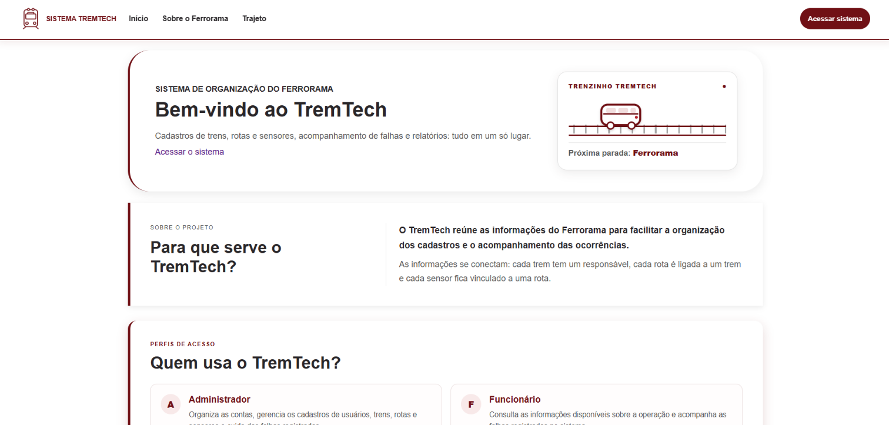
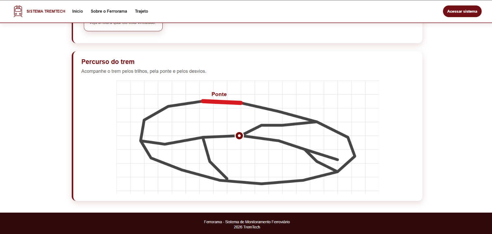
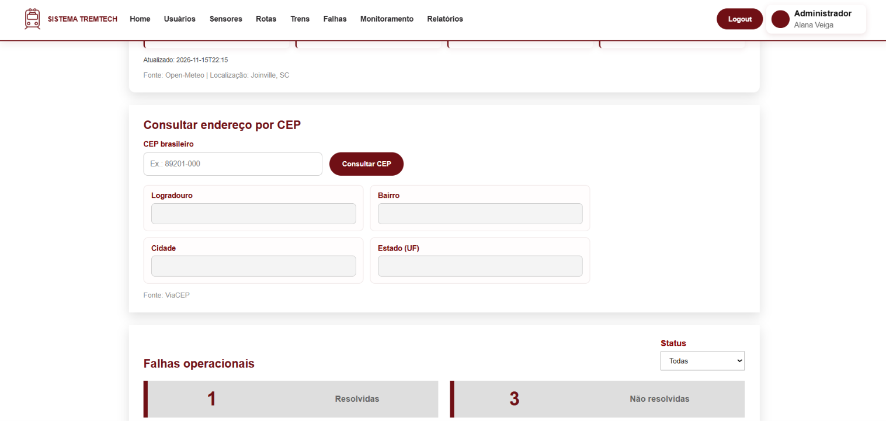
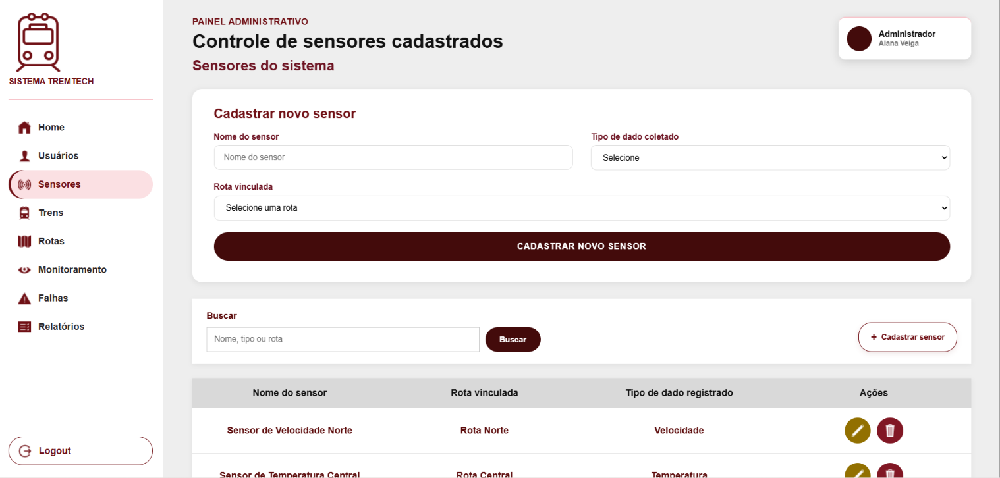
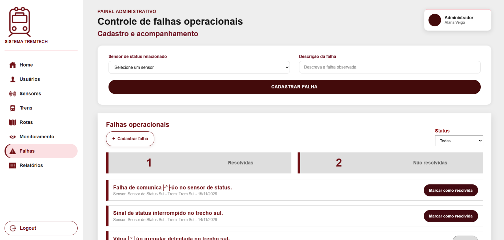
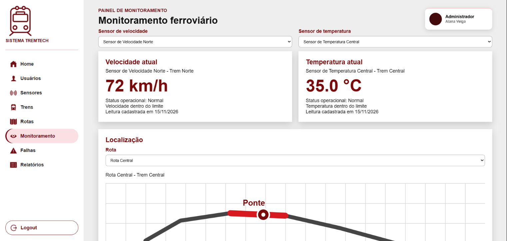
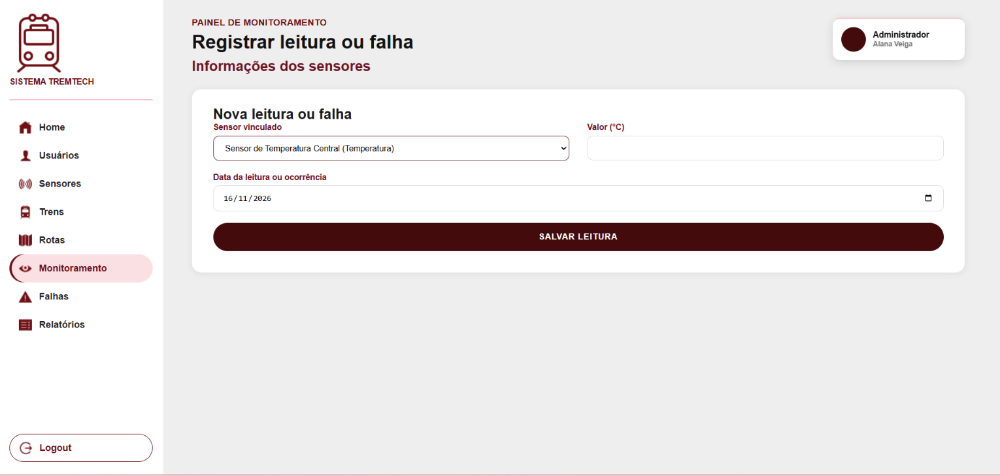
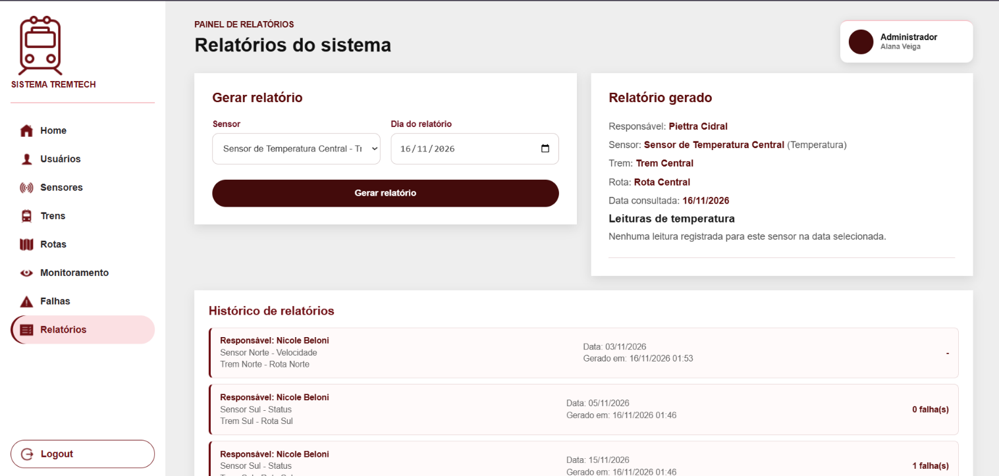

# Ferrorama — TremTech

O TremTech é um sistema web local para organizar as informações da Ferrorama, uma ferrovia em escala com trens e percursos. Ele permite gerenciar usuários, trens, rotas, sensores, leituras e falhas operacionais.

## Problema que o sistema resolve

As informações sobre trens, percursos, responsáveis e falhas podem ficar espalhadas, dificultando a organização da Ferrorama. O TremTech reúne esses dados em um só lugar para facilitar a consulta e o acompanhamento da operação.

## Objetivos e principais funcionalidades

O objetivo do sistema é facilitar a organização e o gerenciamento da Ferrorama.

As principais funcionalidades são:

- Página pública de apresentação do projeto.
- Login com e-mail e senha.
- Acesso separado para administradores e funcionários.
- Cadastro, consulta, edição e exclusão de usuários, trens, rotas e sensores, conforme as permissões e regras do sistema.
- Associação de responsáveis aos trens.
- Associação de trens às rotas e de sensores às rotas.
- Registro manual de leituras de velocidade e temperatura.
- Registro e acompanhamento de falhas.
- Alteração de falhas para resolvidas ou não resolvidas.
- Monitoramento das últimas leituras registradas.
- Visualização de um percurso animado.
- Relatórios por sensor e data, com leituras ou falhas conforme o tipo do sensor.
- Histórico dos relatórios gerados durante a sessão.
- Consulta de clima e de endereço por CEP.

Os requisitos completos estão em [requisitos.md](doc/requisitos.md).
As orientações de uso estão em [manual.md](manual.md).

## Tecnologias utilizadas

- HTML: estrutura das páginas.
- CSS: aparência das telas.
- JavaScript: interações, animações e validações.
- PHP: processamento das funcionalidades.
- MySQL: armazenamento dos dados.
- MySQLi: conexão entre o PHP e o banco de dados.
- Apache e XAMPP: execução local do sistema.
- Git e GitHub: controle de versões e armazenamento do código.
- GitHub Projects: organização das tarefas da equipe.

## Requisitos para executar

- XAMPP com Apache e MySQL.
- Navegador atualizado com JavaScript habilitado.
- Arquivos do projeto e arquivo SQL do banco de dados.
- Internet para utilizar as consultas de clima e CEP e carregar recursos externos.

## Instalação e configuração

- Instale o XAMPP.
- Baixe o ZIP do [repositório do projeto](https://github.com/alanavsilva/s_a_ferrorama).
- Extraia os arquivos.
- Coloque o projeto em `C:/xampp/htdocs/alana_v_silva_2026/s_a_ferrorama/`.
- Confira se o arquivo `index.php` está diretamente dentro da pasta `s_a_ferrorama`.
- Configure o banco de dados seguindo as instruções abaixo.

## Configuração e importação do banco de dados

- Abra o painel do XAMPP.
- Inicie os serviços Apache e MySQL.
- Acesse [phpMyAdmin](http://localhost/phpmyadmin/).
- Clique em **Importar** e selecione o arquivo `database/db.sql` do projeto.
- Execute a importação. O arquivo já contém os comandos para criar e selecionar o banco `SA_FERRORAMA`.
- Confira se as tabelas e os registros iniciais foram importados.
- Abra o arquivo `infra/conexao.php`.
- Confira as configurações de servidor, usuário, senha, banco e porta conforme seu ambiente local.
- A configuração do projeto utiliza o banco `SA_FERRORAMA`, o servidor `localhost` e a porta `3306`.
- Salve as alterações.

O arquivo SQL deve ser importado em uma instalação nova, pois cria as tabelas e inclui os registros iniciais.

As credenciais de acesso às contas iniciais devem ser obtidas com a equipe responsável pelo ambiente. Senhas reais não são apresentadas neste README. Contas de demonstração devem ser fictícias e exclusivas para essa finalidade.

## Como iniciar a aplicação

- Abra o painel do XAMPP.
- Inicie Apache e MySQL.
- Acesse a [página pública](http://localhost/alana_v_silva_2026/s_a_ferrorama/public/Tela_landing/landing.php) ou a [tela de login](http://localhost/alana_v_silva_2026/s_a_ferrorama/index.php).
- Digite o e-mail e a senha de uma conta cadastrada.
- Clique em **Entrar**.
- Após o login, a página inicial será aberta.
- Para sair, utilize a opção de logout e confirme a saída.

Os endereços correspondem à pasta indicada na instalação e ao Apache na porta 80.

## Perfis de acesso e permissões

### Administrador

- Consultar, cadastrar, editar e excluir usuários, trens, rotas e sensores, conforme as regras do sistema.
- Definir e alterar o responsável por um trem.
- Registrar leituras de velocidade e temperatura.
- Registrar falhas.
- Resolver ou reabrir falhas.
- Acessar a página inicial, o monitoramento e os relatórios.

### Funcionário

- Consultar as informações disponibilizadas pelo sistema.
- Acompanhar falhas.
- Acessar a página inicial e o monitoramento.
- Gerar e consultar relatórios.
- Não pode cadastrar, editar, excluir, registrar leituras ou alterar a situação das falhas.

As páginas internas exigem login. As operações administrativas verificam o perfil do usuário no servidor.

## Estrutura geral do projeto

- `assets/style/`: arquivos de estilo.
- `assets/img/`: imagens e capturas de tela.
- `database/db.sql`: criação do banco, das tabelas e dos registros iniciais.
- `doc/`: pesquisas e documentos do projeto.
- `doc/requisitos.md`: requisitos do sistema.
- `infra/conexao.php`: conexão com o banco de dados.
- `infra/auth.php`: autenticação e permissões.
- `infra/apis/`: integração com serviços externos.
- `public/Tela_landing/`: página pública de apresentação.
- `public/Tela_Home/`: página inicial.
- `public/Tela_Usuario/`: gerenciamento de usuários.
- `public/Tela_Trens/`: gerenciamento de trens.
- `public/Tela_Rotas/`: gerenciamento de rotas.
- `public/Tela_Sensores/`: gerenciamento de sensores.
- `public/Tela_Falhas/`: registro e consulta de falhas.
- `public/Tela_Monitoramento/`: monitoramento e registro de leituras.
- `public/Tela_Relatorios/`: geração e consulta de relatórios.
- `script/`: interações e validações em JavaScript.
- `index.php`: tela de login.
- `logout.php`: encerramento da sessão.
- `manual.md`: orientações de uso.
- `README.md`: apresentação e instruções de execução.

## Integrantes e contribuições

- **Alana:** organizou a equipe e a estrutura do projeto, pesquisou sobre CRUD e contribuiu com a documentação, a licença, a estilização e o desenvolvimento de telas.
- **Piettra:** trabalhou no README, no login, nas telas de cadastro e em outras partes da aplicação, além de colaborar com a estilização e os ajustes visuais.
- **Nicole:** desenvolveu a tela de home, pesquisou a identidade visual e colaborou na criação e nos ajustes de outras telas.

## Imagens da versão final

### Página pública

### Login

### Página inicial

### Usuários

### Trens

### Rotas

### Sensores

### Falhas

### Monitoramento

### Registro de leituras

### Relatórios

## Limitações conhecidas

- A execução documentada utiliza um ambiente local.
- As leituras de velocidade e temperatura são registradas manualmente. Não há coleta automática de sensores físicos nesta versão.
- O percurso animado é uma representação visual e não indica a posição real de um trem.
- O histórico de relatórios mantém até 20 registros na sessão e é apagado quando ela termina.
- As consultas de clima e CEP dependem de internet e da disponibilidade dos serviços externos.
- Não há cadastro público de contas nem recuperação de senha pela tela de login. O acesso e a redefinição de senha dependem do administrador.
