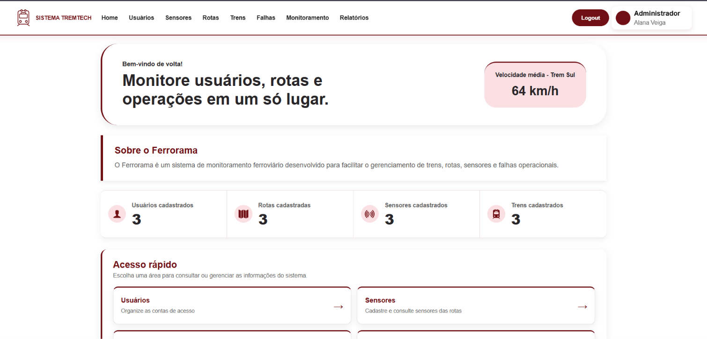
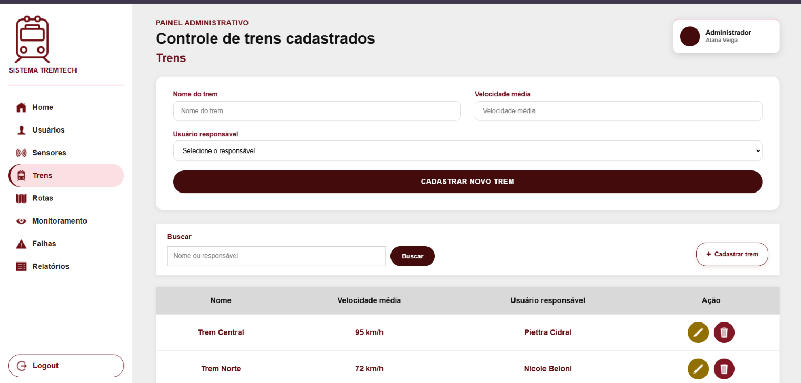

# Ferrorama — TremTech

O TremTech é um sistema web local para organizar as informações da Ferrorama, uma ferrovia em escala com trens e percursos. O sistema permite gerenciar usuários, trens, rotas, sensores, leituras e falhas operacionais.

## Problema que o sistema resolve

As informações sobre trens, percursos, responsáveis e falhas podem ficar espalhadas, dificultando a organização da Ferrorama.

O TremTech reúne essas informações em um só lugar para facilitar a consulta e o acompanhamento da operação.

## Objetivos e principais funcionalidades

O objetivo do sistema é facilitar a organização e o gerenciamento da Ferrorama.

As principais funcionalidades são:

- Página pública de apresentação do projeto.
- Login com e-mail e senha.
- Acesso separado para administradores e funcionários.
- Cadastro, consulta, edição e exclusão de usuários, trens, rotas e sensores.
- Associação de um usuário responsável a cada trem.
- Associação de trens às rotas.
- Associação de sensores às rotas.
- Registro manual de leituras de velocidade e temperatura.
- Registro e acompanhamento de falhas operacionais.
- Alteração de falhas para resolvidas ou não resolvidas.
- Monitoramento das últimas leituras registradas.
- Visualização de um percurso animado.
- Relatórios por sensor e data, com leituras ou falhas conforme o tipo do sensor.
- Histórico dos relatórios gerados durante a sessão.
- Consulta de clima e de endereço por CEP.

## Tecnologias utilizadas

- HTML: estrutura das páginas.
- CSS: aparência das telas.
- JavaScript: interações, animações e validações.
- PHP: processamento das funcionalidades.
- MySQL: armazenamento dos dados.
- MySQLi: conexão entre o PHP e o banco de dados.
- Apache e XAMPP: execução local do sistema.
- Git e GitHub: controle de versões e armazenamento do código.
- GitHub Projects: organização das tarefas da equipe.

## Requisitos para executar

- XAMPP com Apache, MySQL/MariaDB e PHP 8 ou superior com as extensões `mysqli` e `mbstring`.
- Navegador atualizado com JavaScript habilitado.
- Arquivos do projeto e arquivo SQL do banco de dados.
- Internet para utilizar as consultas de clima e CEP e carregar recursos externos.

## Instalação e configuração

- Instale o XAMPP.
- Baixe o projeto em https://github.com/alanavsilva/s_a_ferrorama.
- Extraia os arquivos, caso tenha baixado um ZIP.
- Coloque o projeto dentro da pasta `htdocs` do XAMPP.
- Para utilizar os mesmos endereços apresentados neste README, organize os arquivos em `C:/xampp/htdocs/alana_v_silva_2026/s_a_ferrorama/`.
- Confira se o arquivo `index.php` está diretamente dentro da pasta `s_a_ferrorama`.
- Configure o banco de dados conforme as instruções abaixo.

## Configuração e importação do banco de dados

- Abra o painel do XAMPP.
- Inicie os serviços Apache e MySQL.
- Acesse `http://localhost:8080/phpmyadmin/`.
- Clique em **Importar**.
- Selecione o arquivo `database/db.sql` do projeto.
- Execute a importação. O arquivo já contém os comandos para criar e selecionar o banco `SA_FERRORAMA`.
- Confira se as tabelas e os registros iniciais foram importados.
- A conexão está centralizada em `infra/conexao.php`. O padrão funciona com o XAMPP local: servidor `localhost`, usuário `root`, senha vazia e porta `3306`.
- Se o banco utilizar outros dados, configure no servidor as variáveis `DB_HOST`, `DB_USER`, `DB_PASSWORD`, `DB_NAME` e `DB_PORT`. Não publique senhas reais no código.
- Confira as configurações de servidor, usuário, senha, banco e porta conforme seu ambiente local.
- O nome do banco utilizado pela aplicação é `SA_FERRORAMA`.
- Configure o servidor e a porta do MySQL (normalmente `localhost` e `3306`).
- Use o endereço e a porta do Apache exibidos no XAMPP. Nesta instalação, o acesso é `http://localhost:8080/alana_v_silva_2026/s_a_ferrorama/`.
- Salve as alterações, se houver.

## Como iniciar a aplicação

- Abra o painel do XAMPP.
- Inicie Apache e MySQL.
- Acesse a página pública em `http://localhost:8080/alana_v_silva_2026/s_a_ferrorama/public/Tela_landing/landing.php`.
- Para abrir o login diretamente, acesse `http://localhost:8080/alana_v_silva_2026/s_a_ferrorama/index.php`.
- Digite o e-mail e a senha de uma conta cadastrada.
- Clique em **Entrar**.
- Após o login, a página inicial será aberta.
- Para sair, utilize a opção de logout.

O banco importado possui contas iniciais. As senhas de acesso devem ser obtidas com a equipe responsável pelo ambiente.

Se o projeto estiver em outra pasta ou o Apache utilizar outra porta, ajuste os endereços.

## Perfis de acesso e permissões

### Administrador

- Consultar, cadastrar, editar e excluir usuários, trens, rotas e sensores, conforme as regras do sistema.
- Definir e alterar o responsável por um trem.
- Registrar leituras de velocidade e temperatura.
- Registrar falhas.
- Resolver ou reabrir falhas.
- Acessar a página inicial, o monitoramento e os relatórios.

### Funcionário

- Consultar as informações disponibilizadas pelo sistema.
- Acompanhar falhas.
- Acessar a página inicial e o monitoramento.
- Gerar e consultar relatórios.
- Não pode cadastrar, editar, excluir, registrar leituras ou alterar a situação das falhas.

As páginas internas exigem login. As operações administrativas também verificam o perfil do usuário no servidor.

## Estrutura geral do projeto

- `assets/style/`: arquivos de estilo.
- `assets/img/`: imagens utilizadas no sistema.
- `database/db.sql`: criação do banco, das tabelas e dos registros iniciais.
- `doc/`: pesquisas e documentação do projeto.
- `doc/requisitos.md`: requisitos do sistema.
- `infra/conexao.php`: conexão com o banco de dados.
- `infra/auth.php`: controle de autenticação e permissões.
- `infra/apis/`: integração com serviços externos.
- `public/Tela_landing/`: página pública de apresentação.
- `public/Tela_Home/`: página inicial.
- `public/Tela_Usuario/`: gerenciamento de usuários.
- `public/Tela_Trens/`: gerenciamento de trens.
- `public/Tela_Rotas/`: gerenciamento de rotas.
- `public/Tela_Sensores/`: gerenciamento de sensores.
- `public/Tela_Falhas/`: registro e consulta de falhas.
- `public/Tela_Monitoramento/`: monitoramento e registro de leituras.
- `public/Tela_Relatorios/`: geração e consulta de relatórios.
- `script/`: interações e validações em JavaScript.
- `index.php`: tela de login.
- `logout.php`: encerramento da sessão.
- `manual.md`: orientações de uso.
- `README.md`: apresentação e instruções de execução.

## Integrantes e contribuições

- **Alana:** organizou a equipe e a estrutura do projeto, pesquisou sobre CRUD e contribuiu com a documentação, a licença, a estilização e o desenvolvimento de diferentes telas.
- **Piettra:** trabalhou no README, no login, nas telas de cadastro e em outras partes da aplicação, além de colaborar com a estilização e os ajustes visuais.
- **Nicole:** desenvolveu a tela de home, pesquisou a identidade visual e colaborou na criação e nos ajustes de outras telas do sistema.

## Imagens da versão final

### Página pública

### Login

### Página inicial

### Gerenciamento de trens

### Monitoramento

### Relatórios

## Limitações conhecidas

- A execução apresentada neste README utiliza um ambiente local.
- As leituras de velocidade e temperatura são registradas manualmente. Não há coleta automática de sensores físicos nesta versão.
- O percurso animado é uma representação visual e não indica a posição real de um trem.
- O histórico de relatórios mantém até 20 registros na sessão e é apagado quando ela termina.
- As consultas de clima e CEP dependem de internet e da disponibilidade dos serviços externos.

