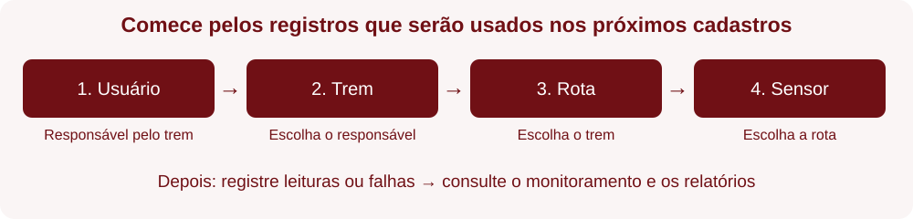

# Manual do usuário — TremTech

**Sistema de monitoramento e gerenciamento ferroviário**  
**Versão:** 1.1 — revisado em 15/11/2026  
**Equipe:** Alana Veiga da Silva, Nicole Beloni da Silva e Piettra Nicole Cidral

Este manual explica, passo a passo e sem exigir conhecimentos técnicos, como entrar no TremTech, consultar as informações e realizar as tarefas permitidas para cada perfil.

## 1. Conheça o sistema

O TremTech organiza informações de usuários, trens, rotas, sensores e falhas operacionais. A página pública apresenta o projeto. Depois do login, o menu leva às telas internas.

O sistema possui dois perfis:

- **Administrador:** pode cadastrar, consultar, editar e excluir registros conforme as regras de cada tela. Também pode registrar falhas e alterar seu estado.
- **Funcionário:** pode consultar as informações disponibilizadas, acompanhar falhas, usar o monitoramento e consultar relatórios. Não pode fazer alterações administrativas.

As opções do menu e os botões disponíveis podem variar conforme o perfil conectado.

## 2. Entrar no sistema

1. No computador com o projeto instalado, abra `http://localhost/alana_v_silva_2026/s_a_ferrorama/index.php`. Se o Apache usar outra porta, inclua-a depois de `localhost`, por exemplo `http://localhost:8080/alana_v_silva_2026/s_a_ferrorama/index.php`. O endereço depende da pasta e da porta usadas na instalação; em outro computador, use o endereço informado pela equipe.
2. Se estiver na página pública, use o acesso ao login. O link **Conheça o Ferrorama**, na tela de login, abre a apresentação do projeto.
3. Na tela de login, digite seu **e-mail** e sua **senha**.
4. Clique em **Entrar**.
5. Se os dados estiverem corretos, a página inicial será aberta.

Você precisa de uma conta previamente cadastrada pelo Administrador. Não existe cadastro público de conta nem botão de recuperação de senha. Para obter acesso ou redefinir a senha, procure o Administrador. Não é necessário instalar um aplicativo: o uso é pelo navegador.

## 3. Usar a página inicial

Depois do login, a **Home** mostra um resumo do sistema e atalhos para outras telas.

- Os cartões mostram a quantidade de usuários, rotas, sensores e trens cadastrados.
- O cartão de velocidade percorre os trens cadastrados. Ele troca o trem exibido periodicamente e mostra a velocidade média registrada no cadastro, alternando a cada três segundos. Esse cartão não mostra a última leitura do sensor; alterar uma leitura não altera a velocidade média do cadastro do trem.
- A área de clima consulta informações externas para Joinville. Se a consulta não estiver disponível, a página pode apresentar uma mensagem de erro.
- A consulta de CEP aceita oito números e, quando encontra o endereço, preenche logradouro, bairro, cidade e estado.
- A área de falhas permite consultar ocorrências por situação. O Administrador também pode resolvê-las ou reabri-las.
- Os atalhos de cadastro aparecem para o Administrador. Para o Funcionário, aparecem opções de consulta compatíveis com seu perfil.

Os totais indicam registros cadastrados, não a quantidade de equipamentos em funcionamento. Os contadores de falhas resolvidas e não resolvidas representam os totais do sistema; o filtro muda a lista de ocorrências, não esses totais. **Resolvida** indica uma ocorrência marcada como concluída; **Não resolvida** indica uma ocorrência ainda em aberto.

O clima é o tempo ambiente de Joinville, e não a temperatura medida em um trem. A consulta de CEP apenas mostra um endereço; não cadastra uma rota nem altera registros.

Para abrir outra tela, clique no nome correspondente no menu: **Home**, **Usuários**, **Sensores**, **Trens**, **Rotas**, **Monitoramento**, **Falhas** ou **Relatórios**.

### Primeiro uso e ordem dos cadastros

Cadastre primeiro o usuário responsável, depois o trem, a rota e o sensor. O sensor recebe o trem por meio da rota escolhida. Se uma opção não aparecer em um formulário, confira se o cadastro anterior já existe.

### Permissões por perfil

| Operação | Administrador | Funcionário |
| --- | --- | --- |
| Consultar usuários, trens, rotas e sensores | Sim | Sim |
| Cadastrar, editar ou excluir esses registros | Sim, respeitando os vínculos | Não |
| Escolher ou alterar o responsável pelo trem | Sim | Não |
| Consultar Home, monitoramento e falhas | Sim | Sim |
| Registrar leituras ou cadastrar falhas | Sim | Não |
| Resolver e reabrir falhas | Sim | Não |
| Gerar relatórios e consultar o histórico da sessão | Sim | Sim |

As restrições também se aplicam ao acesso direto ao endereço de uma ação administrativa. Sem login, as telas internas solicitam autenticação. O perfil e o nome da pessoa conectada aparecem no cabeçalho.

### Como usar as listas

Ao abrir uma área, os registros aparecem em uma tabela. Digite um termo e clique em **Buscar** para filtrar. Para voltar à lista completa, apague o termo e clique novamente em **Buscar**.

Para editar, clique no lápis da linha desejada, altere os campos e clique em **SALVAR ALTERAÇÕES**. Use **Cancelar** para sair da edição sem salvar. Para excluir, clique na lixeira, confira a confirmação e escolha **Excluir** com o nome do registro correspondente; **Cancelar** mantém o registro. A exclusão confirmada não pode ser desfeita pela interface.

## 4. Consultar e gerenciar usuários

A tela **Usuários** mostra as contas cadastradas. O Administrador também pode cadastrar, editar e excluir usuários.

### Cadastrar um usuário

1. Abra **Usuários**.
2. Clique em **Cadastrar usuário** para abrir o formulário.
3. Informe o nome, o e-mail, a senha e o perfil.
4. Clique em **CADASTRAR NOVO USUÁRIO**.
5. Confira a mensagem e procure o novo registro na lista.

O e-mail deve ser válido e não pode estar cadastrado em outra conta. A senha deve ter pelo menos oito caracteres.

### Buscar, editar ou excluir

- Para buscar, digite o nome ou o e-mail no campo **Buscar** e clique em **Buscar**.
- Para editar, use o ícone de lápis na linha da pessoa. Se não quiser trocar a senha, deixe o campo de nova senha vazio.
- Para excluir, use o ícone de lixeira e confirme a ação.

O sistema não permite excluir um Administrador pela tela. Também impede excluir um usuário que ainda seja responsável por um trem. Nesse caso, primeiro edite o trem e escolha outro responsável.

Funcionários podem consultar os registros, mas não veem nem executam as ações administrativas.

## 5. Consultar e gerenciar trens

A tela **Trens** apresenta os trens cadastrados. Para cada trem, o sistema registra o nome, a velocidade média e o usuário responsável.

### Cadastrar um trem

1. Abra **Trens**.
2. Clique em **Cadastrar trem**.
3. Informe o nome e a velocidade média em km/h.
4. Escolha um usuário já cadastrado como responsável.
5. Clique em **CADASTRAR NOVO TREM** e confira o resultado na lista.

A velocidade aceita valores de 1 a 600 km/h. O formulário não possui campo de categoria ou tipo de trem.

### Buscar, editar ou excluir

- Use a busca por nome ou responsável para localizar um trem.
- Use o ícone de lápis para alterar os dados ou trocar o responsável.
- Use a lixeira e confirme para excluir.

Um trem que esteja ligado a uma rota ou sensor não pode ser removido enquanto houver registros dependentes. Altere ou remova os vínculos necessários antes de tentar novamente.

## 6. Consultar e gerenciar rotas

A tela **Rotas** mostra as rotas e o trem relacionado a cada uma.

### Cadastrar uma rota

1. Abra **Rotas**.
2. Clique em **Cadastrar rota**.
3. Informe o nome e a descrição.
4. Informe a distância em quilômetros e o tempo previsto em minutos.
5. Escolha um trem cadastrado e clique em **CADASTRAR ROTA**.
6. Confira a rota na lista. A data de criação é registrada pelo sistema.

O nome deve ter de 3 a 100 caracteres e a descrição é obrigatória, com até 255 caracteres. A extensão deve ser positiva (o formulário aceita a partir de 0,01 km) e o tempo deve ser um número inteiro de minutos, a partir de 1. A rota precisa estar vinculada a um trem existente.

### Buscar, editar ou excluir

- Digite o nome, parte da descrição ou o nome do trem no campo de busca e clique em **Buscar**.
- Use o lápis para editar as informações ou trocar o trem relacionado.
- Use a lixeira e confirme para excluir.

Uma rota com sensores vinculados não pode ser excluída. O vínculo precisa ser resolvido antes.

## 7. Consultar e gerenciar sensores

A tela **Sensores** apresenta o nome dos sensores, a rota vinculada e o tipo de dado registrado. O trem é determinado pela rota; não há seleção separada de trem no formulário do sensor.

### Cadastrar um sensor

1. Abra **Sensores**.
2. Clique em **Cadastrar sensor**.
3. Informe o nome e escolha o tipo de dado: **Velocidade**, **Temperatura** ou **Status**.
4. Escolha uma **Rota vinculada** já cadastrada.
5. Clique em **CADASTRAR NOVO SENSOR** e confira a lista.

O nome do sensor deve ter de 3 a 100 caracteres. Os tipos indicam a informação que poderá ser registrada: velocidade em km/h, temperatura em °C ou ocorrências para o tipo Status. Cadastrar um sensor não registra uma leitura automaticamente.

### Buscar, editar ou excluir

- Busque pelo nome, tipo ou rota.
- Use o lápis para alterar os dados ou os vínculos, escolhendo a rota correta.
- Use a lixeira e confirme para excluir.

Um sensor ligado a uma falha não pode ser excluído, pois a falha usa esse registro como referência. Quando a exclusão de um sensor é permitida, suas leituras numéricas também são apagadas. A interface não oferece exclusão de falhas; se um vínculo impedir a operação, mantenha o registro ou procure a pessoa responsável pelo sistema.

## 8. Registrar e acompanhar falhas

A tela **Falhas** reúne ocorrências registradas. Uma nova falha precisa estar relacionada a um sensor do tipo **Status**.

### Registrar uma falha — Administrador

1. Abra **Falhas**.
2. Clique em **Cadastrar falha**.
3. Escolha o sensor relacionado, do tipo **Status**.
4. Escreva a descrição da ocorrência, com pelo menos cinco e no máximo duzentos caracteres.
5. Clique no botão de cadastro do formulário e confira a mensagem e a lista.

A falha começa como **Não resolvida** e recebe a data e o horário do registro. As falhas são registradas manualmente; um alerta de velocidade não cria uma falha sozinho.

### Consultar e alterar a situação

- Use o filtro para ver todas as falhas, somente as resolvidas ou somente as não resolvidas.
- O Administrador pode clicar em **Marcar como resolvida** para concluir uma ocorrência.
- Para uma ocorrência já resolvida, o Administrador pode clicar em **Reabrir**.
- O Funcionário pode consultar e acompanhar as falhas, mas não pode registrar nem alterar sua situação.

## 9. Acompanhar o monitoramento

1. Abra **Monitoramento**.
2. Escolha separadamente o **Sensor de velocidade** e o **Sensor de temperatura**. A tela atualiza a seleção automaticamente.
3. Leia o valor, o status e a data da leitura cadastrada de cada sensor.
4. Escolha uma **Rota** para identificar o percurso e o trem apresentados junto à ilustração.
5. Consulte as falhas e use o filtro de situação. O Administrador pode resolvê-las ou reabri-las.

Os sensores de velocidade, temperatura e a rota são seleções independentes: confira os nomes apresentados para não atribuir leituras de sensores diferentes ao mesmo trem. A lista de falhas é filtrada pela situação, não pelos sensores ou pela rota selecionados nos cartões.

| Informação | Como interpretar |
| --- | --- |
| Velocidade atual | Última leitura cadastrada para o sensor, em km/h. **Alerta** acima de 100 km/h; **Normal** até 100 km/h. O cartão arredonda para um número inteiro. |
| Temperatura atual | Última leitura cadastrada para o sensor, em °C. **Alerta** acima de 40 °C; **Normal** até 40 °C. O cartão mostra uma casa decimal. |
| Traços no cartão | Não há leitura disponível para aquele sensor. Não significam valor zero nem situação normal. |
| Data da leitura | Dia informado no cadastro. Uma leitura antiga pode continuar aparecendo como a última disponível. |
| Localização e percurso | Animação ilustrativa fixa, com identificação da rota escolhida. Não representa posição real nem reproduz o traçado da rota cadastrada. |

O sistema não recebe medições de sensores físicos. As leituras são informadas manualmente ou vêm dos dados de demonstração. A última leitura é escolhida pela data informada; em caso de empate, aparece a cadastrada por último. Não há atualização contínua por telemetria: atualize a página para consultar novos registros. Um alerta numérico não cria uma falha automaticamente.

### Registrar leitura ou falha — exclusivo do Administrador

1. No fim da tela **Monitoramento**, clique em **Registrar leitura ou falha**.
2. Escolha o **Sensor vinculado**.
3. Para **Velocidade**, informe um valor de 0 a 600 km/h; para **Temperatura**, de 0 a 150 °C. São aceitas até duas casas decimais no formulário.
4. Para **Status**, o campo numérico é substituído por **Descrição da falha**. Escreva de 5 a 200 caracteres.
5. Informe a **Data da leitura ou ocorrência**.
6. Clique em **SALVAR LEITURA** ou **CADASTRAR FALHA**, conforme o sensor escolhido. Confira a mensagem ao retornar ao monitoramento.

O formulário registra apenas a data, sem campo de horário; o registro fica com horário 00:00. Para Status, é criada uma falha não resolvida. Para velocidade e temperatura, é criada uma leitura numérica. A tela não oferece edição ou exclusão individual dessas leituras: confira sensor, valor e data antes de salvar.

## 10. Consultar relatórios

1. Abra **Relatórios**.
2. Escolha um **Sensor** cadastrado.
3. Em **Dia do relatório**, escolha a data desejada.
4. Clique em **Gerar relatório**.
5. Confira o sensor, o tipo, o trem, a rota, o responsável pelo trem e a data consultada.

O conteúdo depende do tipo do sensor:

- **Velocidade:** lista as leituras cadastradas para aquele sensor no dia, em km/h, com duas casas decimais.
- **Temperatura:** lista as leituras do dia em °C, com duas casas decimais.
- **Status:** mostra o total de falhas do sensor no dia, quantas estão resolvidas ou em aberto e a descrição de cada ocorrência.

Se não houver informação para a combinação de sensor e dia, a tela informa que não há leitura ou falha registrada. Tente outra data ou confira o cadastro com o Administrador. Por exemplo, os dados de demonstração do arquivo SQL incluem leituras e falhas nos dias 13, 14 e 15/11/2026.

O **Histórico de relatórios** guarda até 20 consultas recentes na sessão e aparece quando existem consultas anteriores diferentes da atual. É um resumo das consultas, não um arquivo permanente; ao fazer logout, esse histórico é perdido. O resultado atual não é repetido na lista do histórico. O sistema não oferece botão de exportação ou download de PDF. Para atualizar um resultado após novos registros ou mudanças na situação de uma falha, gere o relatório novamente.

## 11. Sair do sistema

Clique em **Logout** no menu ou no cabeçalho. Na confirmação **Sair do sistema?**, clique em **Sair**. Para permanecer conectado, clique em **Continuar no sistema**. A sessão será encerrada e o sistema voltará para a tela de login.

Em computadores compartilhados, sempre faça logout ao terminar de usar o sistema.

## 12. Se algo não funcionar

- **Não consigo entrar:** confira o e-mail e a senha. Se o problema continuar, procure o Administrador.
- **Não aparece nenhum registro:** a lista pode estar vazia ou o filtro de busca pode não encontrar correspondências. Limpe a busca e tente novamente.
- **Não consigo cadastrar ou editar:** essas ações são exclusivas do Administrador. Confira também se os dados obrigatórios foram preenchidos.
- **Não consigo excluir:** o registro pode estar relacionado a outros dados. Veja as orientações de exclusão da tela correspondente.
- **A rota não aparece no cadastro do sensor:** cadastre primeiro o trem e a rota. O sensor seleciona a rota, e o trem vem desse vínculo.
- **Clima ou CEP não carrega:** confira a conexão com a internet e tente novamente mais tarde. Essas consultas externas não impedem o uso dos cadastros principais.
- **Aparece erro de banco de dados ou a página não abre:** peça ajuda à pessoa responsável pela instalação do TremTech.
- **O monitoramento mostra traços:** ainda não existe leitura para o sensor selecionado. Um Administrador deve registrá-la em **Registrar leitura ou falha**.
- **A leitura não aparece como a mais recente:** confira a data informada, o sensor selecionado e atualize a página. Uma leitura com data anterior não substitui a de data mais recente no cartão.
- **Aparece Acesso negado:** a ação exige perfil de Administrador.
- **Aparece Requisição inválida:** abra novamente a tela; se necessário, faça logout e login antes de repetir a operação.
- **Não aparece sensor no cadastro de falha:** é necessário cadastrar um sensor do tipo Status.
- **O relatório está vazio:** confira o sensor e o dia escolhido; os relatórios não agrupam o mês inteiro.

## 13. Dicas de uso

- Confira os dados antes de salvar alterações.
- Verifique o registro selecionado antes de confirmar uma exclusão.
- Escolha vínculos corretos entre usuários, trens, rotas e sensores.
- Não compartilhe sua senha.
- Use somente as ações disponíveis para seu perfil.
- Confira a data das leituras e lembre-se de que o percurso é ilustrativo.
- Faça logout ao terminar.

## 14. Instalação local — equipe responsável

Esta seção é destinada a quem prepara o projeto no computador da demonstração.

1. Coloque a pasta do projeto dentro da pasta `htdocs` do XAMPP.
2. Inicie **Apache** e **MySQL** no painel do XAMPP.
3. Abra o phpMyAdmin e importe `database/db.sql` em uma instalação nova para criar o banco e carregar os dados de demonstração. Não reimporte o arquivo inteiro sobre uma base em uso: ele contém criação de tabelas e registros com identificadores fixos. Se a instalação for antiga, a pessoa responsável deve conferir as atualizações do esquema, incluindo `leituras_sensores` e os campos atuais de falhas.
4. A conexão do projeto está configurada em `infra/conexao.php`. Se o MySQL da máquina usar outros dados, a pessoa responsável pela instalação deve ajustar essa configuração localmente.
5. Abra `http://localhost/<pasta-do-projeto>/index.php` no navegador. Se o Apache estiver usando outra porta, inclua a porta no endereço.

As contas de demonstração estão no arquivo SQL, mas suas senhas em texto não são informadas nele. Antes de entregar o sistema para uso, a equipe deve fornecer uma conta válida e o endereço correto.

## 15. Equipe e suporte

**Sistema:** TremTech  
**Equipe de desenvolvimento:** Alana Veiga da Silva, Nicole Beloni da Silva e Piettra Nicole Cidral.

Para dificuldades de acesso, dúvidas sobre os cadastros ou problemas de instalação, procure a equipe ou a pessoa responsável pela demonstração. Os canais de e-mail e telefone não foram definidos no projeto.
